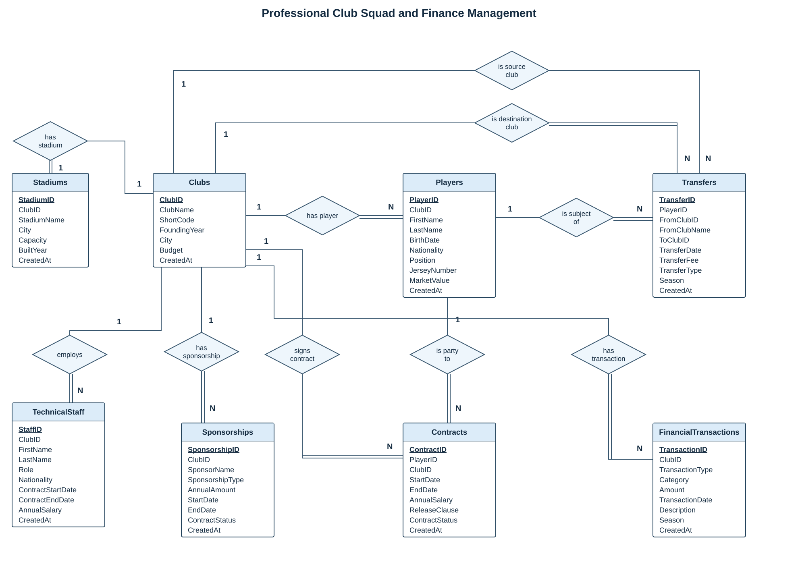

# ⚽ Professional Club Squad & Finance Management

A relational database project for managing football clubs, player squads, contracts, technical staff, stadiums, sponsorships, transfers, and financial transactions in one SQL Server database.

Developed for the **Database Management** course. The database is implemented; a **Python / Django web interface** is planned as the next stage.

## Project Status

| Component | Status |
|---|---|
| Eight-table database schema | Implemented |
| Primary keys, foreign keys, and uniqueness rules | Implemented |
| Data import and organized SQL scripts | Completed |
| E-R diagram | Available below |
| Example reporting and validation queries | Included |
| Django web interface | Planned |
| Views, triggers, and additional validation rules | Planned |
| Fresh database installation test | Pending |

## E-R Diagram



The diagram represents the current database schema. Each table has an independent primary key. Double connection lines indicate total participation; the source-club relationship of a transfer is optional.

## Database Schema

| Table | Purpose | Records in the exported dataset |
|---|---|---:|
| `Clubs` | Club identity, location, founding year, and budget | 18 |
| `Players` | Player identity, position, nationality, squad number, and market value | 517 |
| `Contracts` | Player contracts, annual salaries, dates, and release clauses | 517 |
| `TechnicalStaff` | Coaching staff, roles, contract dates, and salaries | 18 |
| `Stadiums` | Stadium names, locations, capacities, and construction years | 18 |
| `Sponsorships` | Sponsors, agreement types, annual amounts, and dates | 55 |
| `Transfers` | Player movements, source and destination clubs, fees, and seasons | 154 |
| `FinancialTransactions` | Recorded income and expenses by category and season | 216 |

Record counts describe the uploaded SQL export and may change as the project develops.

### Main Relationships

| Parent | Related table | Cardinality | Participation of the related record |
|---|---|---|---|
| `Clubs` | `Players` | 1:N | Each player requires one club |
| `Clubs` | `Contracts` | 1:N | Each contract requires one club |
| `Players` | `Contracts` | 1:N | Each contract requires one player |
| `Clubs` | `TechnicalStaff` | 1:N | Each staff record requires one club |
| `Clubs` | `Stadiums` | 1:1 | Each stadium requires one club; a club may have no stadium record |
| `Clubs` | `Sponsorships` | 1:N | Each sponsorship requires one club |
| `Clubs` | `FinancialTransactions` | 1:N | Each transaction requires one club |
| `Players` | `Transfers` | 1:N | Each transfer requires one player |
| `Clubs` | `Transfers` through `FromClubID` | 1:N | A transfer may have no registered source club |
| `Clubs` | `Transfers` through `ToClubID` | 1:N | Each transfer requires one destination club |

A parent record is not required to have related records. For example, the database permits a club without players or contracts.

## Data Integrity

**Primary keys:** All eight tables have an integer `IDENTITY` primary key.

**Unique values:** `Clubs.ClubName`, `Clubs.ShortCode`, and `Stadiums.ClubID` are unique. The stadium rule allows at most one registered stadium per club in the current design.

**Foreign keys:** Ten foreign keys connect the tables. `Transfers.FromClubID` is nullable; all other foreign-key columns are required.

**Defaults:** Selected fields have defaults, including creation timestamps, active contract status, and certain numeric values. Defaults do not validate the accuracy of imported data.

**Current limitations:** Date-order and nonnegative-amount checks are not yet implemented. Contract and transfer records do not automatically create financial transactions.

## Repository Structure

```text
.
├── README.md
├── database/
│   ├── 01_create_database.sql
│   ├── 02_create_tables.sql
│   ├── 03_sample_data.sql
│   ├── 04_constraints.sql
│   ├── 05_queries.sql
│   └── tables/
│       ├── Clubs.sql
│       ├── Players.sql
│       ├── Contracts.sql
│       ├── TechnicalStaff.sql
│       ├── Stadiums.sql
│       ├── Sponsorships.sql
│       ├── Transfers.sql
│       └── FinancialTransactions.sql
└── docs/
    └── club-er-diagram.svg
```

The `tables` folder contains individual table definitions as an alternative to `02_create_tables.sql`. Use either approach, not both.

## Setup

### Requirements

- Microsoft SQL Server
- SQL Server Management Studio (SSMS)
- Permission to create a database

The original export used database compatibility level **170**. The reorganized scripts omit machine-specific database file paths and exported database-level settings. Compatibility with the target SQL Server installation still needs to be tested.

### Installation Order

Connect to SQL Server in SSMS and execute the following files in order. Check each step for errors before continuing.

| Step | Script | Action |
|---|---|---|
| 1 | `database/01_create_database.sql` | Create `FutbolKadroFinansDB` |
| 2 | `database/02_create_tables.sql` | Create all eight tables |
| 3 | `database/03_sample_data.sql` | Import the complete exported dataset |
| 4 | `database/04_constraints.sql` | Add unique rules, defaults, and foreign keys |
| 5 | `database/05_queries.sql` | Run optional reports and data checks |

These scripts are for a **new database**. They are not repeatable migrations and should not be rerun against an existing populated database. The `sample_data` filename contains the full exported dataset, including all 517 player records.

The split scripts were checked statically for preservation of table definitions and INSERT statements. They have not yet been executed against a fresh SQL Server instance.

## Example Queries

The supplied query file includes:

- Club squad listings.
- Player counts and total market values by club.
- Recorded income, expenses, and net amounts by club and season.
- Checks for source-club name mismatches in transfers.
- Checks for contracts ending before their start dates.

Financial summaries use **only** `FinancialTransactions`. Salary, transfer, and sponsorship values in other tables are not automatically included. A currency field has not yet been defined.

## Planned Web Application

The planned interface will use **Python and Django**, connected to the existing SQL Server database. It has not been implemented yet.

| Module | Planned functionality |
|---|---|
| Clubs | Browse clubs and open a club detail page |
| Squad | View and filter the selected club's players |
| Contracts | Review salaries, contract dates, and status |
| Staff and Stadiums | Display club staff and stadium information |
| Transfers | Browse transfer history and recorded fees |
| Sponsorships | Review agreements and annual amounts |
| Finance | Summarize recorded income and expenses by season |

Initial development will focus on club listings and squad pages, followed by data editing and reporting.

## Development Log

Completed milestones to date:

- Created the SQL Server database and eight tables.
- Imported club, player, contract, staff, stadium, sponsorship, transfer, and financial records.
- Exported the database as SQL scripts and added the project to GitHub.

| Date | Progress |
|---|---|
| 2026-10-16 | Reorganized SQL scripts, added example queries and an E-R diagram, and selected Django for the planned web interface. |

Future entries will record the work completed each week. Earlier milestone dates and course week numbers should be added only after confirming them.

## Next Steps

- [ ] Test the scripts on a fresh SQL Server database.
- [ ] Review inconsistent records and document data sources.
- [ ] Distinguish estimated financial values from verified figures.
- [ ] Create the Django project and configure database access.
- [ ] Build club listing and squad pages.
- [ ] Add a financial-summary view.
- [ ] Add validation rules and triggers where a defined requirement justifies them.
- [ ] Prepare a five-minute demonstration for each course delivery.
