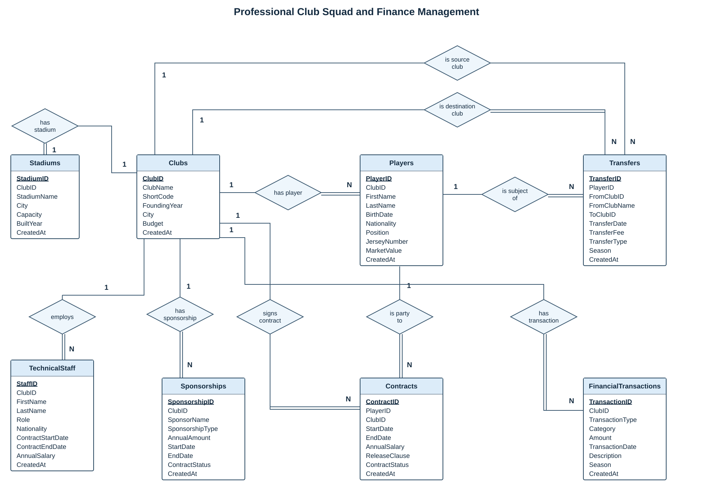

# ⚽ Professional Club Squad & Finance Management

A Database Management course project for managing football clubs, squads, player contracts, technical staff, stadiums, sponsorships, transfers, and recorded financial transactions.

The project combines a **SQL Server relational database** with a **Python / Django management interface**. The interface has been installed and opened locally against the existing database.

## Project Status

| Component | Status |
|---|---|
| Eight core database tables | Implemented |
| Primary keys, foreign keys, unique rules, and defaults | Implemented |
| Organized schema and data scripts | Updated — 20 November 2026 |
| E-R diagram | Available below |
| Django club management interface | Implemented and opened locally |
| Record editing, sponsorship management, and contract renewal | Implemented in the application package |
| Transfer workflows and transaction history | Implemented in the application package |
| Season squad selection and basic eligibility checks | Implemented; requires verified eligibility data |
| Three reporting views and two database audit triggers | SQL definitions included; run scripts 06–07 to activate |

The database files below contain the eight core tables. Django application source and migrations are a separate part of the project and must be committed separately if they are not already present in this repository.

## E-R Diagram



The diagram covers the eight core domain tables. Additional Django authentication and application helper tables are outside this diagram.

## Database Schema

| Table | Purpose | Rows |
|---|---|---:|
| `Clubs` | Club identity, location, founding year, and budget | 18 |
| `Players` | Player identity, squad number, position, nationality, and market value | 517 |
| `Contracts` | Player contract dates, salaries, release clauses, and status | 517 |
| `TechnicalStaff` | Staff names, roles, contract dates, and salaries | 18 |
| `Stadiums` | Stadium identity, location, capacity, and construction year | 18 |
| `Sponsorships` | Sponsors, agreement types, amounts, dates, and status | 55 |
| `Transfers` | Historical player transfers, clubs, fees, and seasons | 154 |
| `FinancialTransactions` | Recorded income and expenses by season and category | 216 |

These counts describe the **20 November 2026 SQL export**. The `03_sample_data.sql` filename contains the complete exported dataset, including all 517 players.

### Main Relationships

| Parent | Related table | Relationship |
|---|---|---|
| `Clubs` | `Players` | One club to many players |
| `Clubs` | `Contracts` | One club to many contracts |
| `Players` | `Contracts` | One player to many historical contracts |
| `Clubs` | `TechnicalStaff` | One club to many staff records |
| `Clubs` | `Stadiums` | One club to at most one stadium record |
| `Clubs` | `Sponsorships` | One club to many agreements |
| `Clubs` | `FinancialTransactions` | One club to many transactions |
| `Players` | `Transfers` | One player to many transfers |
| `Clubs` | `Transfers.FromClubID` | Optional registered source club |
| `Clubs` | `Transfers.ToClubID` | Required registered destination club |

## Data Integrity

- Every core table has an integer `IDENTITY` primary key.
- Ten foreign keys connect the core tables.
- `Clubs.ClubName`, `Clubs.ShortCode`, and `Stadiums.ClubID` have unique constraints.
- `Transfers.FromClubID` is nullable so that an external club can be stored by name without an incorrect registered-club reference.
- Fourteen defaults cover selected timestamps, statuses, and values.
- Additional business validation is implemented in the Django forms and workflows. The eight core tables retain their existing SQL constraints. Script 07 adds CHECK rules to the separate audit table and two audit triggers on Contracts and Sponsorships.

## Repository Structure

```text
.
├── README.md
├── database/
│   ├── 01_create_database.sql
│   ├── 02_create_tables.sql
│   ├── 03_sample_data.sql
│   ├── 04_constraints.sql
│   ├── 05_queries.sql
│   ├── 06_views.sql
│   ├── 07_triggers.sql
│   ├── 08_verify_features.sql
│   └── tables/
│       ├── Clubs.sql
│       ├── Players.sql
│       ├── Contracts.sql
│       ├── TechnicalStaff.sql
│       ├── Stadiums.sql
│       ├── Sponsorships.sql
│       ├── Transfers.sql
│       └── FinancialTransactions.sql
└── docs/
    ├── club-er-diagram.svg
    ├── database-features.md
    ├── contract-sources.md
    └── database-update-2026-11-20.md
```

The individual files in `database/tables/` are an **alternative** to `02_create_tables.sql`. Execute either the combined file or all eight individual table files, not both.

## Database Setup

Requirements: Microsoft SQL Server, SQL Server Management Studio, and permission to create a database.

Use a **new database** and execute these scripts in order:

| Order | File | Purpose |
|---|---|---|
| 1 | `database/01_create_database.sql` | Create `FutbolKadroFinansDB` |
| 2 | `database/02_create_tables.sql` | Create all core tables |
| 3 | `database/03_sample_data.sql` | Load the complete snapshot |
| 4 | `database/04_constraints.sql` | Add unique rules, defaults, and foreign keys |
| 5 | `database/05_queries.sql` | Run optional reports and checks |
| 6 | `database/06_views.sql` | Create or update the three reporting views |
| 7 | `database/07_triggers.sql` | Create the database audit table and two audit triggers |
| 8 | `database/08_verify_features.sql` | Optional local runtime verification; test data changes are rolled back |

For the existing populated database, apply only scripts 06 and 07 to add these features; no fresh data export is needed. Script 08 is optional verification.

Check each step for errors before continuing. These files are installation scripts, not repeatable migrations; do not rerun them on the existing populated project database. Updating the repository does not require executing them on the original database again.

Machine-specific physical database file paths are omitted. Compatibility with the target SQL Server version should be checked before installation. The split scripts have been validated statically but have not been executed on a fresh SQL Server instance in this environment.

## Django Interface

The local interface provides:

- Club and season selection with a dashboard.
- Searchable and paginated lists, record forms, and CSV export.
- Player detail pages, editing, archiving, and eligibility metadata.
- Contract editing and renewal while preserving the previous record.
- Sponsorship, financial transaction, technical staff, and stadium management.
- Historical transfer records and a transactional permanent-transfer workflow between authorized registered clubs.
- Cancellation of application-managed transfers when related records have not changed.
- Draft A-team lists and a basic 2026/27 Süper Lig eligibility precheck.
- Login, global/club-scoped roles, and application change history.

Nationality alone is not used to infer Türkiye national-team eligibility. Missing eligibility data is reported as incomplete. The squad checker is a preliminary check and does not cover every federation exception. Automatic loan returns and an external-club departure workflow are not implemented; such transfers can be maintained as historical records.

The original eight Django models use `managed = False`. Application migrations create the helper/authentication tables separately. User accounts, password hashes, sessions, and helper-table contents are not included in this SQL snapshot.

## Queries and Financial Reporting

`database/05_queries.sql` includes squad listings, player counts and market-value totals, recorded income/expense summaries, and basic consistency checks.

Financial reports use entries in `FinancialTransactions`. Contract, transfer, and sponsorship amounts do not automatically become realized cash movements. The core tables do not have per-row currency fields; values must not be combined across different or unspecified currencies.

## Reporting Views and Audit Triggers

| Object | Purpose |
|---|---|
| `vw_ClubFinancialSummary` | Recorded income, expenses, net movement, and counts by club/season |
| `vw_ClubSquadSummary` | Core player count, goalkeeper count, market-value total, and average age by club |
| `vw_ContractAlerts` | Active-marked contracts that have expired or end within 180 days |
| `trg_Contracts_Audit` | Set-based INSERT/UPDATE/DELETE history for contracts |
| `trg_Sponsorships_Audit` | Set-based INSERT/UPDATE/DELETE history for sponsorships |

The two triggers write to the additional `DatabaseChangeLog` table. The original eight domain tables remain the core project schema; the database log is an additional technical table, alongside the separate Django helpers. It stores old/new JSON and SQL connection metadata. No-op updates are ignored. Audit rows participate in the original transaction and are rolled back with it.

The UI still uses its ORM reports; these views are not yet wired into its dashboard. The database audit log is separate from the application change-history screen. No automatic transfer payment trigger is added, because the application already supports explicit payment recording.

See [installation, examples, compatibility, and verification](docs/database-features.md). Definitions are supplied in GitHub; local SQL Server installation/testing must be confirmed separately.

## Data Sources and Assumptions

Squad information was compiled using Transfermarkt screenshots. Some financial values were estimated with AI assistance and are not verified salary or accounting disclosures. Market value is not the same as annual salary.

On 20 November 2026, contract dates were revised as follows:

- The 405 contract records outside Galatasaray, Fenerbahçe, Beşiktaş, and Trabzonspor use the owner-selected **2026-07-01 to 2029-06-30 project scenario**. These dates are assumptions, not researched disclosures.
- The 112 major-club end dates were checked against the source list in [Contract references](docs/contract-sources.md). Confirmed signed future extensions are included where documented; the existing start dates were retained.
- All monetary values were retained.

Three incorrect transfer source-club IDs and six naming differences were corrected. The Fenerbahçe technical director name was changed to Emre Belözoğlu while preserving the recorded salary. Other staff contract dates and sponsorship dates were retained and still require review.

See [Snapshot verification and changes](docs/database-update-2026-11-20.md) for the exact checks and limits. This is a course project dataset and should not be treated as a fully verified current football or financial registry.

## Development Log

| Date | Completed work |
|---|---|
| 2026-10-16 | Organized SQL scripts and table files, prepared the core E-R diagram, and selected Django for the web interface. |
| 2026-11-20 | Connected Django to the local SQL Server database and installed/opened the management interface. |
| 2026-11-20 | Applied reviewed transfer/name corrections and the contract-date plan; exported and reorganized the updated core data. |
| 2026-11-20 | Added definitions for three reporting views, two audit triggers, and a rollback-based local verification script. |

Add a dated entry each week as development continues. Course week numbers should be added only after checking the actual course calendar.

## Validation and Next Steps

The Django package passed 26 workflow/permission tests on an isolated SQLite database. A test copy of the supplied data rendered 577 authenticated pages, including every player's detail page. These results do not replace SQL Server integration or browser testing.

The current core export retains all 1,513 INSERT statements, all table definitions, and all original constraints. Data checks verified references, date ordering, nonnegative checked monetary fields, and unique non-null squad numbers within each club.

- [ ] Commit the Django application source and migrations if not already in the repository.
- [ ] Test fresh database installation and application workflows on SQL Server.
- [ ] Document additional data sources and distinguish verified from estimated values.
- [ ] Review retained staff/sponsorship dates and major-club contract start dates.
- [x] Prepare reporting-view and database-audit-trigger definitions.
- [ ] Confirm scripts 06–08 on the local SQL Server and connect reporting views to UI pages.
- [ ] Add further database validation where justified.
- [ ] Keep the weekly development log and prepare the course demos.


## Running the Django Application

The Django source is located in `clubs/` and `config/`, with
`manage.py` at the repository root.

### Requirements

- Python 3.12 or newer
- Microsoft SQL Server
- Microsoft ODBC Driver 17 or 18 for SQL Server

### First-Time Setup

Prepare the database using the SQL scripts described above.
Do not reload the sample data into an existing populated database.

Run these commands from the repository root in Windows PowerShell:

```powershell
python -m venv .venv
.\.venv\Scripts\python.exe -m pip install -r requirements.txt
Copy-Item config/settings.example.py config/settings.py
.\.venv\Scripts\python.exe manage.py check
.\.venv\Scripts\python.exe manage.py migrate
.\.venv\Scripts\python.exe manage.py runserver
```

Copy the example settings only for a fresh installation. Existing users
should retain their working `config/settings.py`.

The example uses Windows Authentication, `localhost`, and ODBC Driver 17.
Adjust the database host and driver for your computer.

Open http://127.0.0.1:8000/.

Local demo mode opens without a password and requires a loopback connection
with `DEBUG=True`. Set `TOUCHLINE_LOCAL_DEMO=False` to enable normal login.
For a new administrative account, run `manage.py setup_roles` and
`manage.py createsuperuser`.

Django migrations maintain authentication and application helper tables.
The eight core business models remain unmanaged.

### Current Interface Features

- Club and season selection.
- Record editing, sponsorship management, and contract renewal.
- Permanent transfer workflows and application change history.
- Bulk squad selection and live squad prechecks.
- Labelled estimates for continuing 2002 youth-contingent rights.
- View-based reports and trigger-based database change history.

| Screen | Database objects used |
|---|---|
| Database Reports — season finance | `vw_ClubFinancialSummary` |
| Database Reports — squad summary | `vw_ClubSquadSummary` |
| Database Reports — contract alerts | `vw_ContractAlerts` |
| Database Changes | `DatabaseChangeLog`, populated by `trg_Contracts_Audit` and `trg_Sponsorships_Audit` |

The main dashboard retains its Django ORM queries. The dedicated reporting
screen reads the SQL views directly.

Database Changes displays old/new values for contract and sponsorship
changes made through either Django or SSMS after trigger installation.
Application history remains a separate log.

Verified eligibility metadata takes precedence in squad planning.
Nationality-based classifications and automatically inferred continuation
rights are explicitly labelled estimates, not official TFF verification.
Only players selected in the draft are counted.

### Development Update — 20 November 2026

Added password-free local demo access, view-based reporting,
trigger-history screens, bulk squad selection, live prechecks, and
automatic continuation-right estimates.

The updated application passed 70 tests on an isolated SQLite database.
The supplied dataset rendered 577 pages. These checks do not replace
live SQL Server integration or browser testing.